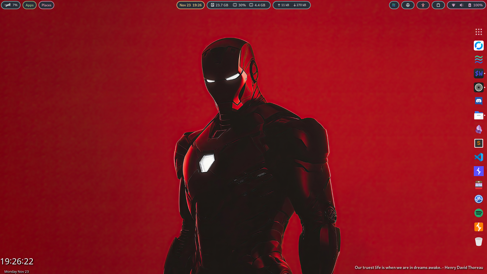

# GnOte

Another slop idea I had during my semester exam lol. Check out the [gnet-utility](https://github.com/psychoSherlock/gnet-utility) too.

A quiet quote on your GNOME desktop. It sits on the wallpaper in the bottom-right corner, shows a fresh quote every hour, and stays out of the way.

<p align="center">
  
</p>
<p align="center">
  
</p>

<sub>The same desktop before and after a refresh.</sub>

## What it does

- Shows a quote and its author, right-aligned with a soft shadow so it reads on any wallpaper.
- Fetches a new random quote every hour, and whenever you ask.
- Remembers the last quote, so it still shows something when you are offline.
- Lets you write your own quote: edit `quote.txt` and the widget updates instantly.

## Using it

- **Drag** with the left mouse button to move it. The position is remembered.
- **Right-click** and choose **Refresh Quote** to fetch a new one.

## Install

Requires GNOME Shell 45 to 49.

```sh
git clone https://github.com/psychoSherlock/gnote.git
cd gnote
make install
```

Then restart GNOME Shell (log out and back in on Wayland) and enable it:

```sh
gnome-extensions enable gnote@psychosherlock
```

To remove it: `make uninstall`.

## Your own quote

The current quote lives in `quote.txt` inside the installed extension folder:

```
~/.local/share/gnome-shell/extensions/gnote@psychosherlock/quote.txt
```

Write anything there and it shows immediately. The next hourly refresh replaces it with a fetched quote.

## Privacy

The only network request is one small call to the [ZenQuotes](https://zenquotes.io) API per refresh. Nothing about you is sent. The widget also stores two small files next to the extension: `quote.txt` (the last quote) and `settings.json` (its position).

Inspirational quotes provided by [ZenQuotes API](https://zenquotes.io).

## Development

```sh
make pack      # build dist/*.shell-extension.zip
```

Layout: `extension.js` is the whole extension; `metadata.json` describes it.

## License

MIT. See [LICENSE](LICENSE).

## Author

AI Slop by psychoSherlock
